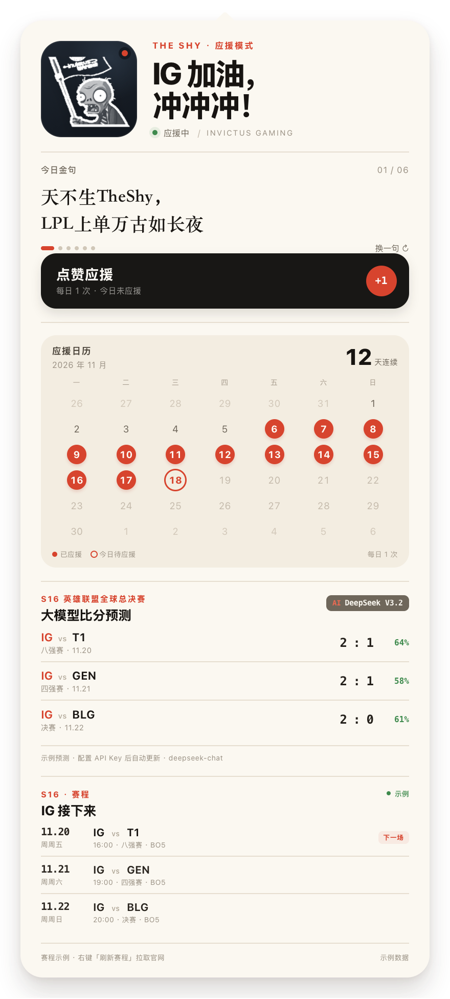
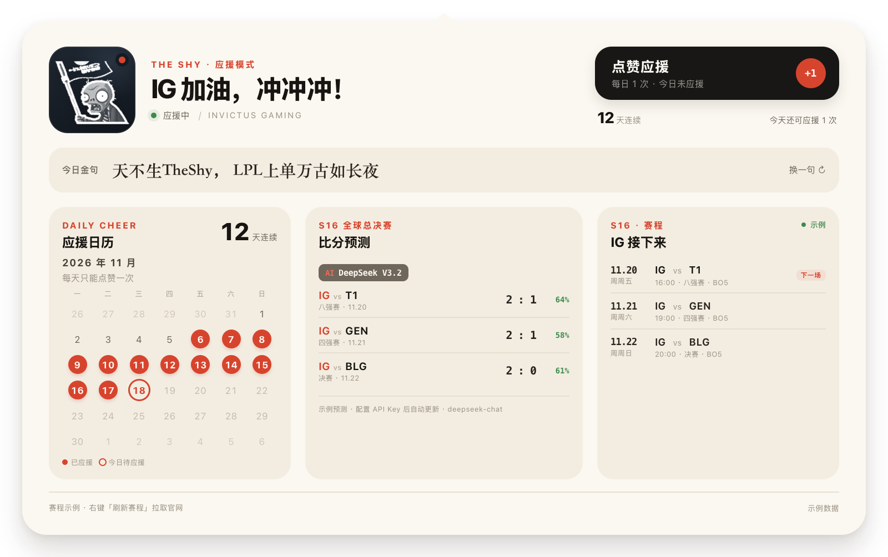

# IG 应援

一个只为 Invictus Gaming 打 Call 的 macOS 菜单栏小工具。

左键点菜单栏图标打开应援面板；右键打开设置菜单。支持纵向长卡与横向仪表盘两种布局，可在菜单中随时切换。

<p align="center">
  <br>
  
</p>

> 预览图为透明背景，不含本机路径或本地模型信息；其中赛程和预测使用演示数据。

## 功能

- **每日点赞应援**：每天只能点一次；按钮完成后变为「今日已应援」。
- **应援日历与连续天数**：月历标出已应援日期，显示当前连续应援天数。
- **S16 大模型比分预测**：读取 IG 的世界赛赛程，调用已配置的 OpenAI 兼容模型；面板上展示模型型号。
- **多套模型配置**：可同时保存 DeepSeek、OpenAI 等兼容接口配置，随时切换当前预测模型。
- **API Key 加密存储**：Key 使用 AES-GCM 加密后写入本地配置文件；主密钥保存在 macOS 钥匙串。
- **官网赛程同步**：附带无 Token 的抓取脚本，从 lolesports.com 公共赛程页提取 IG 比赛。
- **金句配置**：金句从纯文本文件读取，改完重新打开面板即可生效。
- **纯菜单栏应用**：`LSUIElement`，不显示 Dock 图标；面板 20 秒自动收起，点空白处立即收起。

## 界面与交互

### 纵向长卡

适合快速看一眼今日金句、应援状态和下一场赛程。

- 头像、`IG 加油，冲冲冲！` 与状态行。
- 「今日金句」支持轮播与「换一句」。
- 每日一次「点赞应援」。
- 月历、连续天数、比分预测和赛程纵向展开。

### 横向仪表盘

适合在桌面宽度下同时查看日历、预测和赛程。

- 日历 / 比分预测 / 赛程三列并排。
- 当前模型显示在预测卡顶部。
- 只有一场待预测比赛时，卡片会按内容收紧，不留下大块空白。

右键菜单 →「展示模式」可切换，选择会记住。

## 安装与构建

源码目录内执行：

```bash
./build.sh
```

脚本会编译、打包、ad-hoc 签名，并安装到：

```text
/Applications/IG应援.app
```

首次启动没有 Dock 图标，只在菜单栏出现。当前版本：`0.1.0`（build 6）。

## 模型配置与 API Key 安全

右键菜单 →「预测模型」→「模型配置…」。

每套配置包含：

- **显示名称**：面板 AI 徽章上展示的型号名，例如 `DeepSeek V3.2`。
- **模型标识**：请求体中的 `model`，例如 `deepseek-chat`。
- **Base URL**：OpenAI 兼容接口地址，通常以 `/v1` 结尾。
- **API Key / Token**：可选；保存时加密。
- **设为当前预测模型**：预测时使用这一套配置。

### 加密方式

- API Key 使用 **AES-GCM** 加密，配置文件中只保存密文。
- 256 位主密钥保存在 **macOS 钥匙串**，不写入配置文件。
- 配置文件权限设置为 `0600`。
- 支持多套配置并存；切换模型不会覆盖已有 Key。
- 本地无鉴权的 OpenAI 兼容服务可以留空 Key；远程服务必须配置 Key。

配置默认保存在：

```text
~/Library/Application Support/IGCheer/models.json
```

## S16 赛程同步（无需 Token）

脚本通过 lolesports.com 的公开赛程页提取内嵌的比赛数据，不依赖 API Token：

```bash
python3 tools/fetch_schedule.py
```

默认输出：

```text
~/Library/Application Support/IGCheer/schedule.json
```

常用参数：

```bash
python3 tools/fetch_schedule.py --print              # 只打印，不写文件
python3 tools/fetch_schedule.py --team IG --league worlds
python3 tools/fetch_schedule.py --out /tmp/ig.json   # 自定义输出路径
```

应用内也可以右键 →「刷新赛程（官网 · 无需 Token）」直接同步。脚本使用 Python 标准库，无需安装第三方依赖。

## 每日应援数据

每日点赞记录保存在：

```text
~/Library/Application Support/IGCheer/cheer.json
```

只记录日期键（如 `2026-11-01`），用于绘制月历和计算连续天数；同一日期重复点击不会增加记录。

## 金句配置

金句从纯文本读取：

```text
~/Library/Application Support/IGCheer/quotes.txt
```

首次启动自动创建。每行一句，空行和 `#` 开头的注释行会被忽略；用 `|` 强制换行，例如：

```text
天不生TheShy，|LPL上单万古如长夜
```

右键菜单 →「打开金句配置…」可直接打开文件。文件为空或读取失败时回退到内置 6 句。

## 项目结构

```text
ig-cheer/
├── Sources/
│   ├── main.swift              # 菜单栏、窗口与菜单
│   ├── Models.swift            # 配置、加密、日历、赛程、预测数据
│   ├── PredictionClient.swift  # OpenAI 兼容比分预测请求
│   ├── PanelWebView.swift      # 本地面板 WebView 宿主
│   ├── SettingsView.swift      # 模型配置窗口
│   ├── panel.html
│   ├── panel.css
│   └── panel.js
├── assets/                     # 运行时资源
├── artwork/                    # 原始插画素材
├── docs/                       # README 预览图
├── tools/
│   ├── fetch_schedule.py       # 无 Token 官网赛程抓取
│   ├── make_assets.swift       # 抠图 + App 图标
│   ├── make_bust_gray.swift    # 菜单栏灰阶半身图标
│   ├── make_avatar.swift       # 面板白灰头像
│   └── regenerate.sh           # 一键重新生成图标资源
├── build.sh
└── README.md
```

`build/` 是构建临时目录，不纳入源码。

## License

代码以 [MIT License](LICENSE) 开源。

IG 名称、标识与僵尸插画版权归各自权利人所有，不在 MIT 授权范围内；仓库中的相关图片仅用于构建和展示这个个人应援项目，详见 [NOTICE.md](NOTICE.md)。
