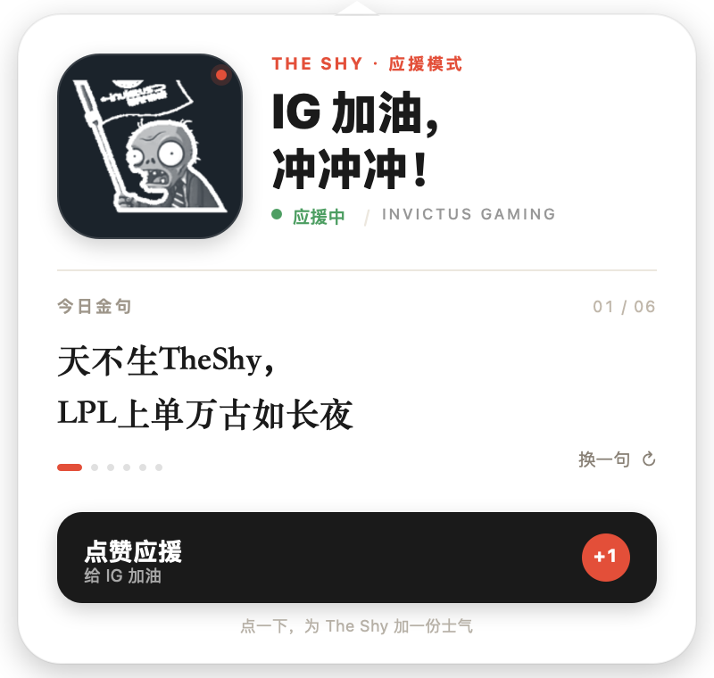
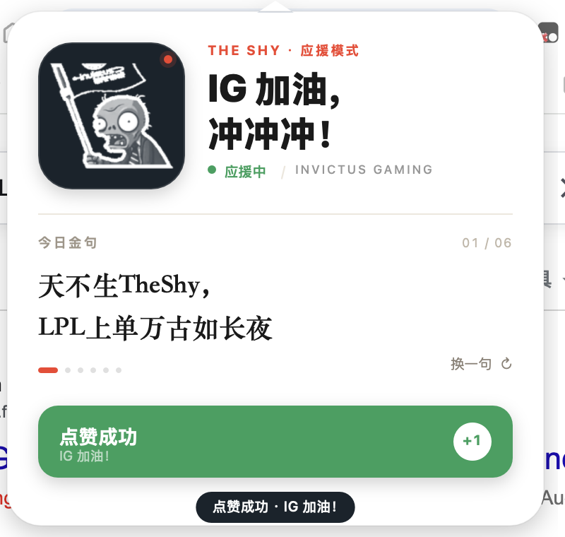

# IG 应援

一个只为 Invictus Gaming 打 Call 的 macOS 菜单栏小工具。

- **左键点击**菜单栏上的僵尸图标：下拉一张 V1 名片式应援卡，包含大号灰阶头像、一句金句和「点赞应援」按钮。
- **右键 / Control-点击 / Option-点击**：打开菜单（再喊一次、登录时自动启动、打开金句配置、关于、退出）。
- 纯本地运行，无语音播报、无网络请求、不采集任何数据。
- 面板 6 秒自动收起；点「点赞应援」或「换一句」会重新计时；点面板空白处立即收起。

## 安装位置

`/Applications/IG应援.app`

启动后没有 Dock 图标，只出现在菜单栏（LSUIElement）。当前版本：`0.0.5`。

## 面板

V1 名片式布局：

- 左侧 104px 深海军蓝圆角头像块，放完整抠图的「旗 + 僵尸半身」白灰版，右下角有小红色状态点。
- 右侧 `THE SHY · 应援模式`、`IG 加油，冲冲冲！`、绿色「应援中」状态行。
- 下方「今日金句」区，金句按 `01 / 总数` 轮播，点「换一句 ↻」切换，底部圆点同步。
- 主按钮文案为 **「点赞应援」**，点击后变绿色「点赞成功 / IG 加油！」并出现短暂 toast。
- 面板尺寸 400 × 380。

## 金句配置

金句不写死在代码里，而是从下面这个纯文本文件读取：

```text
~/Library/Application Support/IGCheer/quotes.txt
```

首次启动会自动创建，并写入当前 6 句作为默认内容。右键菜单里的 **「打开金句配置…」** 可以直接打开它。

格式：

- 每行一句，空行和以 `#` 开头的注释行会被忽略。
- 想在一句里强制换行，用 `|` 分隔，例如 `天不生TheShy，|LPL上单万古如长夜`。
- 请保持纯文本 UTF-8 编码；保存后重新打开面板即可生效，不需要重启 App。
- 如果文件为空或读取失败，会自动回退到内置的 6 句，不会让面板空白。

金句顺序（默认内容，严格保留原文）：

1. 天不生TheShy，LPL上单万古如长夜
2. 天神下凡一锤四
3. 剑气纵横三万里，一剑光寒十九州
4. 大莽夫带三尺剑立不世之志
5. 五花马千金裘，多喝几杯不算愁
6. 一半天使，一半恶魔

## 图标

菜单栏只有一个图标：**灰阶半身**，22pt，从原图完整抠出的「旗 + 僵尸半身」直接转灰阶，保留白/灰纹理。

通过多级 alpha 编码明暗：亮部接近纯白，暗部为半透明灰，外加 1px 实边保证轮廓；`isTemplate = true`，深色菜单栏呈白/灰，浅色菜单栏自动变黑/灰。提供 22 / 44 / 66px PNG，Retina 下不糊。

App 图标（Finder / 关于面板）：深蓝圆角方块 + 白色 `IG` 字标 + 绿色 `应援` + 红色短横线。

## 项目结构

```text
ig-cheer/
├── Sources/
│   └── main.swift                 # App 全部逻辑
├── assets/                        # 只放运行时会打包进 App 的资源
│   ├── AppIcon1024.png
│   ├── avatar_bust_white.png
│   ├── MenuIconGrayBust.png
│   ├── MenuIconGrayBust@2x.png
│   └── MenuIconGrayBust@3x.png
├── artwork/
│   └── zombie.png                 # 原始素材，仅用于重新生成资源
├── docs/
│   ├── panel-v1.png               # 面板预览
│   └── panel-v1-clicked.png       # 点赞态预览
├── tools/
│   ├── make_assets.swift          # 抠图 + App 图标
│   ├── make_bust_gray.swift       # 菜单栏灰阶半身图标
│   ├── make_avatar.swift          # 面板白灰头像
│   └── regenerate.sh              # 一键重新生成全部资源
├── .gitignore
├── build.sh
└── README.md
```

`build/` 是构建时生成的临时目录，不纳入源码。

## 重新构建

```bash
cd ~/WorkSpace/Fullstack-WorkSpace/ig-cheer
./build.sh          # 编译、打包、ad-hoc 签名并安装到 /Applications
```

重新生成图标资源（可选）：

```bash
./tools/regenerate.sh
```

它会按顺序运行 `make_assets`、`make_bust_gray`、`make_avatar`，自动清理中间文件，最终只保留：

- 菜单栏图标 `assets/MenuIconGrayBust.png` / `@2x` / `@3x`
- 面板头像 `assets/avatar_bust_white.png`
- App 图标 `assets/AppIcon1024.png`（1024×1024）

原始素材 `artwork/zombie.png` 保留不动。

## 预览





## License

代码以 [MIT License](LICENSE) 开源。

IG 名称、标识与僵尸插画版权归各自权利人所有，不在 MIT 授权范围内；仓库中的相关图片仅用于构建和展示这个个人应援项目，详见 [NOTICE.md](NOTICE.md)。
